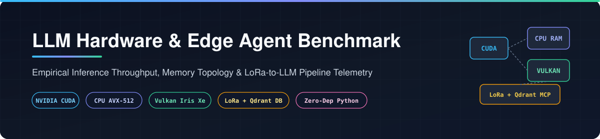
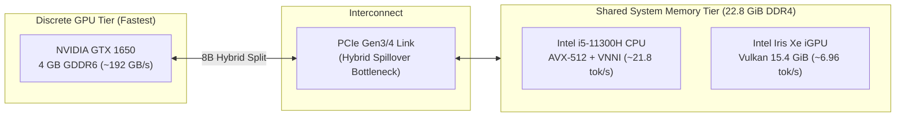
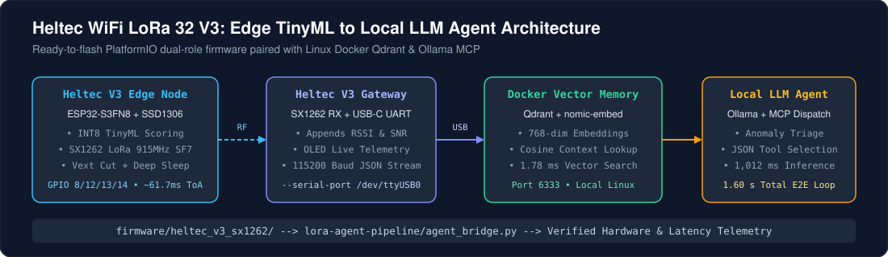
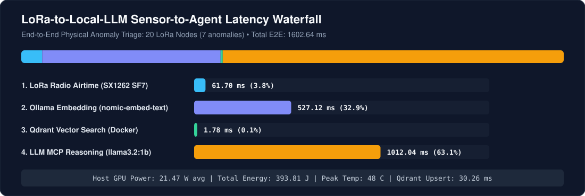
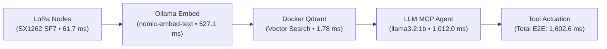

<div align="center">



<br/>

[](benchmark.py)
[](https://ollama.com)
[](results/gtx_1650_i5_11300h/summary.md)
[](results/intel_iris_xe_vulkan/summary.md)
[](lora-agent-pipeline/docker-compose.yml)

**A reproducible, multi-system benchmark suite evaluating local LLM throughput across discrete GPUs, CPU system memory, integrated GPUs, and distributed LoRa-to-LLM agent pipelines.**

[Leaderboard](#-cross-system--memory-tier-leaderboard) · [Architecture](#-memory-topology--architecture) · [LoRa Agent Pipeline](#-lora-to-local-llm-agent-pipeline) · [Replicate](#-how-to-replicate-on-any-machine) · [Full Blog Post](BLOG_POST.md)

</div>

---

## 📊 Visual Performance Overview


---

## 🏆 Cross-System & Memory-Tier Leaderboard

All benchmarks run with **zero-temperature greedy decoding** across a fixed **128-token output ceiling** after runner eviction and warm-up caching:

| System ID | Compute / Memory Tier | Model | Prompt (tok/s) | Generation (tok/s) |
| :--- | :--- | :--- | :---: | :---: |
| `gtx_1650_i5_11300h` | **Full VRAM Offload** (CUDA GTX 1650 4 GB) | `llama3.2:1b` | `3,121.19` | **105.03** |
| `cpu_ram_i5_11300h_310ghz` | **CPU + System RAM** (`--num-gpu 0`) | `llama3.2:1b` | `701.53` | **21.80** |
| `intel_iris_xe_vulkan` | **Intel Iris Xe iGPU** (Vulkan Unified RAM) | `llama3.2:1b` | `302.92` | **6.96** |
| `gtx_1650_i5_11300h` | **Full VRAM Offload** (CUDA GTX 1650 4 GB) | `llama3.2:3b` | `1,763.39` | **63.13** |
| `cpu_ram_i5_11300h_310ghz` | **CPU + System RAM** (`--num-gpu 0`) | `llama3.2:3b` | `488.92` | **17.02** |
| `intel_iris_xe_vulkan` | **Intel Iris Xe iGPU** (Vulkan Unified RAM) | `llama3.2:3b` | `199.48` | **5.14** |
| `gtx_1650_i5_11300h` | **Hybrid Offload** (VRAM + System RAM) | `llama3.1:8b` | `169.44` | **8.18** |
| `cpu_ram_i5_11300h_310ghz` | **CPU + System RAM** (`--num-gpu 0`) | `llama3.1:8b` | `136.69` | **6.29** |
| `intel_iris_xe_vulkan` | **Intel Iris Xe iGPU** (Vulkan Unified RAM) | `llama3.1:8b` | `78.28` | **3.34** |

> [!TIP]
> **Why CPU Outperforms the Integrated GPU (~3× Faster):** On Intel Tiger Lake (`i5-11300H`), CPU cores leverage **AVX-512** and **VNNI** vector extensions paired with GGML's `CPU_REPACK` kernels. Because both the CPU and the Intel Iris Xe iGPU share the same dual-channel DDR4 memory bus, CPU inference (`21.80 tok/s`) outperforms generic Vulkan shaders on the iGPU (`6.96 tok/s`)—explaining why Ollama drops integrated GPUs by default unless `OLLAMA_IGPU_ENABLE=1` is set.

---

## 🧠 Memory Topology & Architecture



---

## 📡 LoRa-to-Local-LLM Agent Pipeline & Heltec V3 Firmware

Beyond standalone token generation, [`lora-agent-pipeline/`](lora-agent-pipeline/) and [`firmware/heltec_v3_sx1262/`](firmware/heltec_v3_sx1262/) implement a complete cyber-physical feedback loop: on-device INT8 edge anomaly scoring on **Heltec WiFi LoRa 32 V3 (ESP32-S3 + SX1262)** boards feeding a Dockerized **Qdrant** vector database and **MCP tool-calling** local LLM agent.







<details>
<summary><b>▶ View Full Pipeline Telemetry & Run Instructions</b></summary>

- **Burst Profile:** 20 simulated LoRa nodes (SX1262, SF7, 24-byte payload), 7 critical bearing anomalies triaged
- **LoRa Time-on-Air:** `61.70 ms`
- **Ollama Embedding (`nomic-embed-text`):** `527.12 ms`
- **Qdrant Vector Upsert / Search:** `30.26 ms` / `1.78 ms`
- **LLM MCP Reasoning (`llama3.2:1b`):** `1,012.04 ms`
- **Total End-to-End Anomaly Triage:** **`1,602.64 ms`** (~1.60 s)
- **Host GPU Power & Thermal Profile:** `21.47 W` avg | `393.81 J` total | Peak `48 °C`

```bash
cd lora-agent-pipeline
docker compose up -d

# Mode A: Stress-test with simulated 20-node SX1262 burst
python3 agent_bridge.py --nodes 20 --sf 7 --llm-model llama3.2:1b --delete-after

# Mode B: Ingest live RF packets from a Heltec WiFi LoRa 32 V3 USB gateway
python3 agent_bridge.py --serial-port /dev/ttyUSB0 --nodes 20 --llm-model llama3.2:1b

docker compose down -v
```

</details>

---

## 🚀 How to Replicate on Any Machine

Clone this repository on any Linux, macOS, or Windows (WSL) workstation running Ollama. The `--delete-after` flag automatically pulls missing test models, executes the benchmark, updates the leaderboard, and deletes the weights from disk afterward.

```bash
git clone https://github.com/mdphd97/llm-hardware-benchmark.git
cd llm-hardware-benchmark

# 1. Benchmark default compute (CUDA / Metal / Auto)
python3 benchmark.py --models llama3.2:1b llama3.2:3b llama3.1:8b --delete-after

# 2. Force pure CPU + System RAM execution (0 GPU layers)
python3 benchmark.py --num-gpu 0 --models llama3.2:1b llama3.2:3b llama3.1:8b --delete-after

# 3. Regenerate SVG visual charts from updated results/
python3 generate_charts.py
```

<details>
<summary><b>▶ Repository Structure, Rig Specs & Unit Tests</b></summary>

### Test Rig Specifications (`mdphd`)
- **CPU:** 11th Gen Intel Core i5-11300H @ 3.10GHz (4 Cores / 8 Threads)
- **RAM:** 22.8 GiB DDR4
- **Discrete GPU:** NVIDIA GeForce GTX 1650 Mobile (4,096 MiB GDDR6, CUDA 13.2, Driver 595.99.02)
- **Integrated GPU:** Intel TigerLake-LP GT2 [Iris Xe Graphics] (15.4 GiB Unified via Vulkan)
- **OS:** Ubuntu Linux (`x86_64`) | **Runtime:** Ollama `0.40.12`

### Directory Layout
```text
├── assets/                     # Auto-generated SVG banners, charts & Heltec architecture
├── firmware/heltec_v3_sx1262/  # PlatformIO C++ firmware for Heltec WiFi LoRa 32 V3 (ESP32-S3 + SX1262)
├── lora-agent-pipeline/        # Docker Qdrant + LoRa SX1262/USB bridge + MCP Agent stress test
├── results/                    # Per-system JSON logs & cross-hardware LEADERBOARD.md
├── benchmark.py                # Zero-dependency multi-system benchmark & runner eviction tool
├── generate_charts.py          # Zero-dependency SVG chart generator
├── test_benchmark.py           # Unit test suite
├── BLOG_POST.md                # Publication-ready technical review article
└── README.md
```

### Run Unit Tests
```bash
python3 -m unittest test_benchmark.py
python3 -m unittest discover -s lora-agent-pipeline -p "test_*.py"
```

</details>
